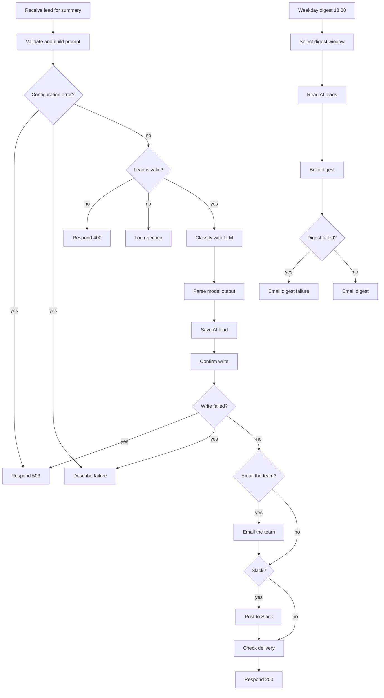

# AI lead summary and daily digest

Two triggers in one workflow. The webhook asks an OpenAI-compatible chat model for a short summary, an intent, and a priority, stores that JSON, and alerts the team. A weekday schedule compiles the rows already in the sheet into one email. The digest does not call the model.



## Credentials

| Node | Credential type | Name to use |
| --- | --- | --- |
| Receive lead for summary | Header Auth | `Lead Summary Webhook Header Auth` |
| Classify with LLM | Bearer Auth | `LLM Bearer Auth` |
| Google Sheets nodes | Google Sheets OAuth2 | `Google Sheets account` |
| Gmail nodes | Gmail OAuth2 | `Gmail account` |
| Post to Slack | Slack API | `Slack account` |

The bearer credential sends `Authorization: Bearer <token>`. Paste the provider key there. The workflow URL stays `https://api.openai.com/v1/chat/completions` until you change `llmUrl` in **Validate and build prompt**. The URL has to be `https` and cannot contain a username or password. `model` ships as `gpt-4o-mini`. Some newer models want `max_completion_tokens` instead of `max_tokens`; that field is `maxTokens` in the same block.

Header name: `X-Webhook-Secret`. Use a different secret from LeadFlow.

## Sheet

Tabs `AI Leads`, `AI Rejections`, and `Errors`. Headers are in `templates/AI_Leads.csv`, `templates/AI_Rejections.csv`, and `templates/Errors.csv`. Replace `YOUR_SHEET_ID` in **Validate and build prompt** and in **Select digest window**.

AI Leads columns include `summary`, `intent`, `priority_score`, `priority_reason`, `review_required`, `parse_status`, and `model`.

## How the model call is constrained

The system message tells the model to treat the user message as data and to return one JSON object. Lead fields are JSON-encoded with angle brackets removed. The HTTP node requests `response_format: json_object`, times out at 20 seconds, and does not follow redirects.

**Parse model output** keeps a summary of at most 400 characters, an intent in `new_project`, `support`, `pricing`, `partnership`, `spam`, or `other`, an integer priority from 1 to 5, and a reason of at most 240 characters. Any other payload, a non-2xx response, or a transport failure stores this fallback and sets `review_required` to `true`:

- summary: `Summary unavailable. Manual review required.`
- intent: `other`
- priority: `1`
- reason: `Model output failed validation.`
- `parse_status`: `fallback`

The raw model text is discarded. The team email escapes the summary before sending it. The webhook response does not include it.

Invalid leads are rejected with HTTP 400 and appended to AI Rejections. They are not sent to the model and not saved on AI Leads.

## Daily digest

The schedule is `0 18 * * 1-5` in the n8n instance timezone. The sample compose file sets `America/Sao_Paulo`. The email lists today's rows, counts by intent, and notes how many need review. It shows at most `digestMaxRows` (50) rows. A sheet that cannot be read produces a short failure email with no provider error text, instead of an empty "no leads" digest.

Execute the **Weekday digest** trigger manually in the editor to send one digest without waiting for 18:00.

## Test cases

```bash
export AI_WEBHOOK_URL=http://127.0.0.1:5678/webhook-test/lead-summary
export AI_WEBHOOK_SECRET='the header value'
node scripts/send-sample-payloads.mjs --dir scripts/payloads/ai-summary
```

| Payload | Expect |
| --- | --- |
| `01-valid-project.json` | 200 `accepted`. A row on AI Leads. Intent and priority come from the model, or the fallback if the model call fails. |
| `02-prompt-injection.json` | 200 `accepted`. The message tries to raise the priority and close a system tag. The stored summary is either a normal classification or the fallback. The webhook body does not echo it. The team email shows the name escaped. |
| `03-invalid-email.json` | 400 `invalid_email`. No model call and no AI Leads row. |
| `04-missing-fields.json` | 400 with the missing-field codes. |

Malformed model output is not something the webhook can force. The fixtures in `scripts/fixtures/model-output/` are what the parser receives in `node scripts/test-guards.mjs`:

| Fixture | Result |
| --- | --- |
| `valid.json` | Accepted. The extra `ignore` key is dropped. |
| `fenced.txt` | Accepted. A JSON fence is unwrapped. |
| `not-json.txt`, `fenced-invalid.txt` | Fallback |
| `missing-keys.json` | Fallback |
| `bad-intent.json`, `bad-score.json`, `score-string.json` | Fallback |
| `array.json` | Fallback |

To see the fallback inside n8n, point `llmUrl` at an `https` endpoint you control that returns `not json` with status 200, run `02-prompt-injection.json`, and confirm `parse_status` is `fallback`.
