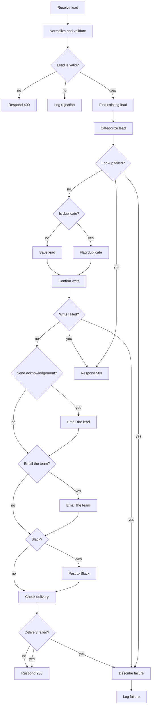

# LeadFlow

Website lead capture and routing. A contact form's backend posts a lead. The workflow checks it, drops invalid leads, flags duplicates, classifies the rest, stores the row, and tells the lead and the team.



## Credentials

Create these in n8n before publishing. On import, n8n will ask you to map each one because the file stores the id `PLACEHOLDER`.

| Node | Credential type | Name to use |
| --- | --- | --- |
| Receive lead | Header Auth | `LeadFlow Webhook Header Auth` |
| Google Sheets nodes | Google Sheets OAuth2 | `Google Sheets account` |
| Gmail nodes | Gmail OAuth2 | `Gmail account` |
| Post to Slack | Slack API | `Slack account` |

Header Auth fields: Name `X-Webhook-Secret`, Value from `openssl rand -hex 32`. The Slack app needs `chat:write`, and the bot has to be in the channel.

## Sheet

Use the headers in `templates/`. Tabs: `Leads`, `Duplicates`, `Rejections`, `Errors`. One spreadsheet is enough. Put its id in **Normalize and validate**, replacing `YOUR_SHEET_ID`.

The Leads tab needs its header row before the first real request. If the lookup cannot read that tab, the caller gets HTTP 503 and the lead is not saved. That avoids inserting a row that was never checked for a duplicate.

Two requests for the same new email, arriving together, can both pass the lookup and both be saved. The sheet is checked and then appended. It is not a lock. A client who needs a hard unique constraint should move the dedupe key to a database.

## Configuration

**Normalize and validate** holds the sheet id, tab names, `team@example.com`, the Slack channel `leads`, and the notify flags. `notifySlack` ships as `false`. Set it to `true` after the Slack credential works. `sendLeadAck` and `notifyTeamEmail` ship as `true`.

**Categorize lead** is the routing table. First match wins.

| Rule id | Service | Budget tier | Priority | Queue |
| --- | --- | --- | --- | --- |
| `web_enterprise` | website | enterprise (10000+) | high | sales-senior |
| `web_project` | website | growth or scale (500–9999) | normal | sales |
| `web_starter` | website | starter (0–499) | low | sales |
| `web_discovery` | website | unscored | normal | sales |
| `automation_enterprise` | automation | enterprise | high | automation |
| `automation` | automation | starter, growth, or scale | normal | automation |
| `automation_discovery` | automation | unscored | normal | automation |
| `consulting` | consulting | any | normal | consulting |
| `general` | other | any | low | inbox |

Service aliases, in that same node: `web`, `site`, and `landing page` map to website; `n8n`, `zapier`, `make`, and `workflow` map to automation; `consult` and `consultancy` map to consulting. Anything else is `other`.

`500` is growth, `2000` is scale, and `10000` is enterprise. An empty or non-numeric budget is unscored. A negative amount is unscored.

After you edit the source instead of the imported workflow, run `node scripts/build-workflows.mjs` from the repository root and import again.

## What the caller receives

| Situation | HTTP | Body |
| --- | --- | --- |
| New lead saved | 200 | `{ "ok": true, "status": "accepted" }` |
| Email already on the Leads tab | 200 | `{ "ok": true, "status": "duplicate" }` |
| Invalid email, missing fields, or oversize text | 400 | `{ "ok": false, "status": "rejected", "errors": ["..."] }` |
| Sheet lookup or save failed | 503 | `{ "ok": false, "status": "unavailable" }` |

A failed acknowledgement or team notification still returns 200 when the row was saved. **Check delivery** appends an Errors row such as `delivery:ack` when Gmail does not return a thread id or Slack does not return a `ts`. The execution log has the provider error.

The acknowledgement subject is fixed. The body greets the lead and does not repeat their message.

## Test cases

Start the workflow listening, or publish it, then:

```bash
export WEBHOOK_URL=http://127.0.0.1:5678/webhook-test/leadflow
export WEBHOOK_SECRET='the header value'
node scripts/send-sample-payloads.mjs --dir scripts/payloads/leadflow
```

Use `/webhook/leadflow` after the workflow is published. The script sends the header `X-Webhook-Secret` and does not follow redirects.

| Payload | Expect |
| --- | --- |
| `01-web-starter.json` | 200, category `web_starter`. A second run is a duplicate. |
| `02-duplicate-web-starter.json` | 200 `duplicate` once 01 has been stored. Row goes to Duplicates. |
| `03-web-project-growth.json` | 200, `web_project` (budget 1500) |
| `04-web-project-scale.json` | 200, `web_project` (budget 5000) |
| `05-web-enterprise.json` | 200, `web_enterprise` |
| `06-web-discovery.json` | 200, `web_discovery` (no budget) |
| `07-automation.json` | 200, `automation` (`n8n` alias, budget 800) |
| `08-automation-enterprise.json` | 200, `automation_enterprise` |
| `09-automation-discovery.json` | 200, `automation_discovery` (`zapier`, budget "not sure") |
| `10-consulting.json` | 200, `consulting` |
| `11-general.json` | 200, `general` (service Copywriting) |
| `12-invalid-email.json` | 400 `invalid_email`. No Leads row. |
| `13-missing-fields.json` | 400 with `missing_name`, `missing_email`, `missing_service`, `missing_message`. |
| `14-formula-injection.json` | 200. The company cell is text and begins with a quote. It does not calculate. |

Length limits, negative budgets, and the formula helper are covered by `node scripts/test-guards.mjs`.
